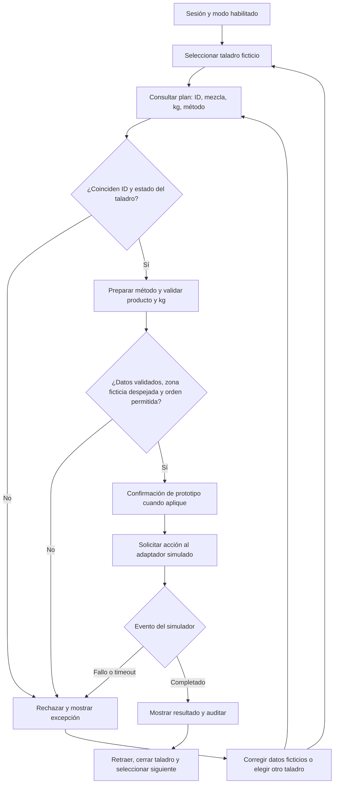

# Faro v1 — alcance, decisiones y preguntas

**Fecha:** 3 de noviembre de 2026 · **Estado:** contrato interno del equipo para el prototipo · **Entrega:** 10 de noviembre de 2026.

Este documento desarrolla F-01. La fuente de las declaraciones de ORICA es el [análisis del briefing](../Analisis_briefing_Faro_ORICA_2026-10-28.md), que indica los minutos aproximados de la grabación. Una inferencia de diseño de Faro se identifica como tal. Ningún punto de este documento autoriza operar una MMU real.

## Problema y usuario

El usuario modelado es el operador responsable de una unidad móvil de fabricación y carguío (MMU). Según el briefing, trabaja taladro por taladro con un diseño previo que indica producto y cantidad; consulta o confirma esos datos, posiciona brazo o manguera según el método, ejecuta el carguío, retrae el elemento y avanza. En campo puede encontrar un taladro distinto del diseño. Fuente: briefing 03:00–04:10, 06:15–06:48 y 13:50–14:17.

Faro v1 representa ese trabajo mediante **una consola y una MMU simuladas** en una laptop. La voz local ofrece una forma de emitir consultas y órdenes cerradas. Un motor determinista decide qué solicitud puede enviarse al simulador; el simulador devuelve eventos de avance o fallo. Los controles físicos, el PLC, los sistemas de iniciación y los datos operativos de ORICA quedan fuera del prototipo.

## Contrato del producto

| Elemento | Definición de v1 | Origen y estado |
| --- | --- | --- |
| Operador | Una sesión ficticia visible, asociada a modo voz o manual simulado; no hay biometría. | ORICA desea que mande solo el responsable (26:15–26:43); método de identificación pendiente. |
| Malla | Archivo local versionado con al menos tres taladros inventados. | El diseño previo por taladro fue descrito por ORICA (13:50–14:17); los datos son decisión del equipo. |
| Taladro | ID único, producto, kg previstos, método y estado. Un taladro activo por vez. | Campos inspirados en el flujo descrito; estructura y valores propuestos por Faro. |
| Acciones | Consultar/seleccionar, preparar, extender o retraer brazo/manguera, validar producto/kg, cargar, pausar, cerrar y avanzar, todo simulado. | Secuencia y acciones base: 03:00–04:10, 09:15–10:00, 14:00–14:17; frases exactas pendientes de ORICA. |
| Estados | Sin selección, consultado, preparado, confirmación pendiente, en curso, cargado, cerrado, excepción/revisión y fallo. | Modelo de producto propuesto por Faro; la confirmación está integrada en el flujo local del simulador, no es una autorización industrial. |
| Decisión | Una transcripción es entrada; aceptación exige estado, sesión, plan e interbloqueos ficticios válidos. | Regla de seguridad del prototipo propuesta por Faro, no procedimiento oficial. |
| Resultado | «Completado» aparece solo tras evento final correlacionado del simulador. | ORICA pidió respuesta breve de ejecución (26:43–27:40); correlación es diseño de Faro. |
| Registro | SQLite guarda entrada, decisión, motivo, estado y eventos; sin audio crudo por defecto. | Trazabilidad propuesta por Faro; política de datos de ORICA pendiente. |

## Ciclo de un taladro

El diagrama resume el producto; F-02 fijará el orden exacto de cada comando y F-04 las transiciones. La «revisión humana simulada» representa un bloqueo y una explicación en pantalla; no confiere autorización para cambiar un plan real.

## Guiones verificables

**Caso normal:** iniciar sesión ficticia; elegir modo voz o manual de prueba; seleccionar un taladro válido; consultar ID, producto y kg; preparar el método; **validar producto y kg contra el plan antes del movimiento**; comprobar zona ficticia despejada; solicitar movimiento, confirmar explícitamente y observar `pendiente → aceptada → en curso → completada`; ejecutar carga simulada; confirmar acciones críticas; retraer; cerrar; pasar a otro taladro. En cada paso la UI debe mostrar el estado confirmado y la bitácora debe conservar el ID de cada comando y sus eventos correspondientes.

**Excepción de plan:** seleccionar un taladro válido y dictar kg o mezcla distintos del plan. Faro muestra valor recibido y plan, rechaza la carga y registra el motivo **sin avanzar el estado operativo**. La discrepancia queda como alerta pendiente. Repetir «sí» o «cargar» no libera el bloqueo; una nueva declaración que coincida exactamente con el plan ficticio puede resolver la alerta y volver a la validación. Ningún dato de ORICA se modifica.

**Excepción de ejecución:** con una solicitud aceptada, el adaptador simulado demora o falla. Faro mantiene «en curso» o «requiere revisión» y no anuncia éxito. Una respuesta tardía con otro ID no cambia el taladro activo. Esta prueba pertenece a F-05 y F-23.

## Decisiones y supuestos registrados

| ID | Decisión o supuesto | Tipo | Base | Responsable | Efecto si ORICA indica otra cosa |
| --- | --- | --- | --- | --- | --- |
| D-01 | Priorizar flujo de carguío por taladro y movimientos simples. | Interpretación del briefing | 01:47–02:13, 03:00–04:10, 09:15–10:00 | Producto | Ajustar prioridad y vocabulario; preservar contrato del adaptador. |
| D-02 | Usar malla, cantidades, productos y sensores totalmente ficticios. | Decisión del equipo | Falta de datos operativos autorizados | Producto/lógica | Sustituir fixtures solo tras recibir datos de prueba autorizados. |
| D-03 | Ejecutar ASR local con escucha explícita; «Oye Faro» es prefijo durante escucha. | Decisión del equipo | Cabina descrita 07:05–07:55; no se exigió wake word | Voz | Evaluar otro mecanismo con métricas de activación y seguridad. |
| D-04 | Proponer reglas y confirmación de prototipo para ciertas acciones, condicionadas a la integración de F-22; bloquear discrepancias. | Decisión del equipo | ORICA habló de alerta por desvíos 14:34–15:40 | Lógica/producto | Rehacer matriz F-02 según reglas escritas de ORICA; no trasladar reglas actuales a campo. |
| D-05 | Modos voz/manual simulados excluyentes. | Respuesta de ORICA + diseño | 25:40–26:12, 28:25–29:05 | Integración | Adecuar transferencia cuando se conozca interfaz y prioridad física. |
| D-06 | Sesión ficticia sin reconocimiento biométrico. | Decisión del equipo | Emisor responsable 26:15–26:43, método no especificado | Producto | Adoptar método aprobado y revalidar amenazas en fase posterior. |
| D-07 | No implementar conexión a MMU/PLC/LOADPlus/ProBlast. | Límite técnico | Interfaz no confirmada 11:10–11:43, 15:51–17:00 | Integración | Diseñar primero lectura en entorno de prueba autorizado; cualquier escritura exige revisión industrial. |
| D-08 | Mensajes breves basados en eventos terminados. | Respuesta de ORICA + diseño | 26:43–27:40 | Interfaz | Ajustar lenguaje con operadores sin alterar correlación de eventos. |
| D-09 | Demostrar localmente sin Internet. | Decisión del equipo | Restricciones de red comentadas 17:05–17:45 | Integración | Podría añadirse sincronización futura; el control local seguiría sujeto a validación. |
| D-10 | Usar un solo taladro activo y una acción pendiente a la vez. | Supuesto del equipo | Simplificación del prototipo | Lógica | Revisar estados, concurrencia y pruebas si operación real difiere. |

## Preguntas pendientes para ORICA

**Canal:** comité organizador, según briefing 20:22–20:49. **Estado al 6 de noviembre:** preparadas; este repositorio no acredita envío ni respuesta. Producto debe registrar fecha, remitente, respuesta textual autorizada y cambio de decisión antes de marcar una pregunta como respondida.

| ID | Pregunta concreta | Para qué se necesita | Dueño | Decisiones/issues afectados | Si no hay respuesta antes de v1 |
| --- | --- | --- | --- | --- | --- |
| Q-01 | ¿Qué acción prefieren priorizar y qué resultado observable indicaría éxito? | Enfocar flujo y pitch. | Producto | D-01, F-02, F-19 | Mantener recorrido ficticio completo. |
| Q-02 | ¿Pueden mostrar un carguío normal y una excepción con pantalla y datos no sensibles? | Confirmar secuencia, estados y términos. | Producto | D-01, F-01 a F-04 | Mantener flujo como hipótesis informada. |
| Q-03 | ¿Qué órdenes por voz prohíben y cuáles requieren confirmación, supervisor o paro físico? | Definir límites de una fase industrial. | Producto/seguridad | D-04, F-02, F-21, F-22 | Usar solo interbloqueos ficticios rotulados. |
| Q-04 | ¿Qué MMU/control/versiones y entorno de prueba podrían documentar para un piloto? | Evitar inferir un protocolo. | Integración | D-07, F-05 | Sin adaptador real. |
| Q-05 | ¿Cómo identifican y habilitan al operador responsable y cómo manejan otra voz en cabina? | Definir sesión y amenazas de suplantación. | Producto/voz | D-06, F-07, F-11 | Sesión ficticia sin biometría. |
| Q-06 | ¿Qué micrófono/EPP, ruido autorizado y frases naturales pueden compartir? | Diseñar evaluación representativa. | Voz | D-03, F-09 a F-11 | Medir solo condiciones de laboratorio descritas. |
| Q-07 | Si el taladro difiere del plan, ¿quién modifica kg/mezcla y cómo se autoriza y registra? | Modelar excepción real. | Producto | D-04, F-06 | Bloquear carga y mostrar revisión ficticia. |

## Revisión interna de F-01

- [x] Los hechos del briefing están vinculados a minutos aproximados del análisis existente.
- [x] Los supuestos y decisiones de Faro están separados de las respuestas de ORICA.
- [x] Cada respuesta pendiente tiene dueño y efecto previsto sobre el alcance.
- [x] El caso normal y dos excepciones se pueden recorrer sin hardware real.
- [x] Se revisó la dependencia con F-22 y se documentó que la confirmación integrada solo protege el simulador local; no autoriza equipos reales.
- [x] Una segunda persona del equipo revisó el flujo y registró observaciones en `ACTA_REVISION_F01.md` (`f01_review_final`, 2026-11-06). Las respuestas de ORICA permanecen como preguntas pendientes.
