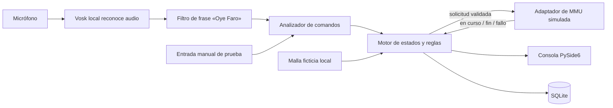

# Faro — arquitectura técnica y decisiones de tecnología

**Estado:** arquitectura del prototipo de simulación implementado; no describe una integración industrial.
**Alcance:** simulador de una unidad móvil de fabricación y carguío (MMU) basado en el briefing de ORICA. Ningún componente controla maquinaria real.

## Decisión principal

Faro será **una aplicación de escritorio local con un único proceso**. El reconocimiento convierte audio en texto, un analizador cerrado extrae la intención, el motor de reglas decide si se admite en el estado actual, y un adaptador de MMU simulada responde con eventos de ejecución. La interfaz muestra el resultado y SQLite conserva la trazabilidad.



La frontera crítica está entre **texto reconocido** y **solicitud validada**. No habrá llamada desde el ASR o un botón de la UI directamente al adaptador. El simulador nunca se confundirá con LOADPlus, ProBlast o un PLC real.

## Tecnologías elegidas para v1

| Función | Tecnología | Motivo y límite |
| --- | --- | --- |
| Lenguaje y dominio | **Python 3.12**, `dataclasses`/`Enum`, tipos | Un solo lenguaje para voz, reglas, interfaz y pruebas; ya funciona en la laptop. Las reglas deben ser puras y probables sin Qt. |
| Consola de cabina simulada | **PySide6 Essentials / Qt Widgets** | Escritorio nativo, señales entre hilo de voz y UI, interfaz formal; existente en el proyecto. |
| Reconocimiento offline | **Vosk español** + `sounddevice` | Funciona localmente y permite limitar vocabulario; ya existe un primer canal. Debe evaluarse con personas y ruido. |
| Comandos | **Gramática cerrada y analizador determinista** | Permite rechazo explícito y trazable de números, IDs y órdenes ambiguas. Un LLM no autoriza acciones. |
| Datos del escenario | **JSON versionado** con malla ficticia | Fácil de revisar, cambiar y reproducir. El plan real de ORICA no se incluye en el repositorio. |
| Bitácora local | **SQLite** | Transacciones y consulta sin servicio de base de datos; audio crudo no se almacena. |
| Pruebas | **pytest** + corpus WAV etiquetado | Comprueba transiciones, rechazos, modo manual y falsas aceptaciones. Las métricas de voz se informan por condición. |
| Integración futura | **Interfaz de adaptador** con implementación simulada | Se puede estudiar un adaptador de pruebas solo tras recibir documentación, permisos y revisión de seguridad. |

Las versiones usadas localmente al revisar este plan son PySide6 Essentials 6.12.0, Vosk 0.3.45, sounddevice 0.5.6 y pytest 9.1.1. Antes de la entrega se fijarán versiones compatibles y se repetirá la instalación desde cero.

Con la captura activada manualmente, Vosk continúa procesando el audio localmente para reconocer «Oye Faro». La puerta de voz descarta las transcripciones sin ese prefijo antes de que lleguen al parser o a la bitácora. La frase no activa el micrófono por sí sola; una activación de espera de bajo consumo queda fuera de v1.

## Docker y Go: decisión explícita

### Docker

**Sí para pruebas aisladas y reproducibles del código sin micrófono; no como entorno de la demostración.** Un contenedor puede ejecutar pruebas del motor, del analizador y de persistencia, y después servir en CI. La consola Qt y la captura de audio en Windows se validan nativamente en la laptop. El Dockerfile de este repositorio ejecuta pruebas; no incluye el modelo de voz ni pretende abrir una interfaz gráfica. En esta máquina Docker CLI está instalado, pero el daemon no estaba iniciado al revisar el plan, así que la imagen requiere una construcción de verificación posterior.

### Go

**No introducirlo en v1.** Separar hoy un servicio en Go obligaría a diseñar IPC, empaquetar dos runtimes y repartir las reglas entre procesos sin una necesidad demostrada. Go podría evaluarse en una fase industrial para una pasarela aislada si ORICA exigiera un protocolo específico, supervisión de procesos o hardware con requisitos que Python no cumpla. Esa decisión necesitaría mediciones y especificaciones del sistema real; no se justifica por una preferencia de lenguaje.

### Otras tecnologías consideradas

- **LLM local:** reservado, si aporta valor, para ayuda o consulta de documentación; nunca como autoridad de control. No es requisito de v1.
- **Prefijo obligatorio en voz:** cada orden hablada debe empezar con «Oye Faro», ya sea en la misma frase o seguido por una orden dentro de seis segundos. «Faro» solo y los prefijos dentro de una frase no activan órdenes. Un detector que encienda el micrófono desde reposo queda fuera de v1 y requeriría pruebas de falsas activaciones.
- **TTS local:** útil solo para confirmaciones breves después de probar inteligibilidad; la pantalla sigue mostrando el estado.
- **LoRa, nube, Bluetooth y servidor web:** no se necesitan para la ruta de voz local a simulador. El briefing no confirmó una interfaz física para estos canales.
- **PostgreSQL o microservicios:** no aportan al prototipo de una sola laptop y crean dependencias de red/operación.

## Contratos entre componentes

**Entrada:** `{source, transcript, session_id, timestamp}`. El analizador produce `{intent, hole_id?, product?, kg?}` o `unknown/ambiguous`. No se infiere un número ausente.

**Decisión:** `{accepted, reason, state_before, state_after, command_id}`. La validación incluye sesión, modo, taladro, plan, estado y señales ficticias del simulador. Una orden rechazada no modifica el estado operacional.

**Ejecución:** el adaptador recibe un `command_id` ya autorizado y devuelve `accepted → in_progress → completed` o `rejected/failed/cancelled`. La UI muestra «completado» solo tras `completed`. Una respuesta tardía o duplicada no debe completar un comando distinto.

**Auditoría:** guardar entrada, interpretación, decisión, inicio, fin/fallo y motivo con marcas de tiempo y `command_id`; no guardar audio por defecto. Los IDs y cantidades del plan son ficticios.

## Estructura activa del código

```text
app.py                         composición de la aplicación Qt
faro/
  controller.py                 coordinación de entradas, confirmación y eventos
  domain.py                     estados, sesión y reglas del flujo por taladro
  parser.py                     interpretación de vocabulario cerrado
  voice_pipeline.py             conexión parser-dominio
  voice.py                      captura y reconocimiento local
  simulator.py                  adaptador ficticio de MMU
  plan.py, scenarios.py         fixtures y escenarios de demostración
  audit.py                      persistencia SQLite
  ui.py                         presentación, navegación y entrada manual
  presentation.py               snapshot de operación para la interfaz
  messages.py                   textos de estado y ejecución
  legacy/
    indicator_review.py         experimento anterior, fuera del runtime
tests/                          pruebas agrupadas por módulo y legacy/
scripts/                        instalación, diagnóstico, evaluación y validación
planning/                       decisiones, evidencia y guía de entrega
```

La aplicación activa sigue el flujo `app.py → FaroController → VoicePipeline/Parser → FaroDomain → SimulatedMMU → AuditStore`. La UI solo renderiza snapshots y emite entradas; el simulador y el dominio no dependen de Qt ni del micrófono. El motor inicial de revisión auxiliar y sus pruebas están aislados bajo `legacy/` para que no se confundan con el producto del reto.

## Distribución y control de calidad

1. **Desarrollo:** entorno virtual de Python en Windows, modelo Vosk local y fixtures ficticios.
2. **CI:** pruebas unitarias y de integración sin micrófono; arranque Qt en modo offscreen cuando corresponda. No cargar el video del briefing ni voces reales a CI.
3. **Docker:** ejecutar pruebas sin interfaz; no usarlo para validar captura de micrófono o ergonomía.
4. **Entrega:** carpeta de aplicación y modelo verificada sin Internet en la laptop. Evaluar `pyside6-deploy` en modo de carpeta independiente si el tiempo lo permite; debe probarse en una máquina limpia antes de prometer un instalador.
5. **Repositorio:** privado, con `.gitignore` para datos, modelos, audio, entornos y resultados. Solo código, fixtures ficticios y documentación de trabajo autorizada.

## Condiciones para una fase de integración real

ORICA tendría que identificar la MMU y versión de control, entregar documentación de señales/protocolo y un entorno de prueba, definir órdenes permitidas y prohibidas, reglas de interbloqueo, identidad del operador, prioridad de controles físicos, gestión de cambios y responsable de validación. El primer adaptador físico debería limitarse a **lectura de estado**; cualquier escritura exigiría análisis de riesgos y pruebas conjuntas. Este plan no atribuye a ORICA una aprobación técnica que no dio en el briefing.

## Fuentes técnicas

- [Qt for Python: despliegue de aplicaciones de escritorio](https://doc.qt.io/qtforpython-6/deployment/index.html)
- [Qt for Python: `pyside6-deploy`](https://doc.qt.io/qtforpython-6/deployment/deployment-pyside6-deploy.html)
- [Vosk: reconocimiento offline y API de streaming](https://alphacephei.com/vosk/)
- [Docker Desktop para Windows: instalación y entorno](https://docs.docker.com/desktop/setup/install/windows-install/)
- [GitHub Actions: pruebas de Python](https://docs.github.com/en/actions/tutorials/build-and-test-code/python)
